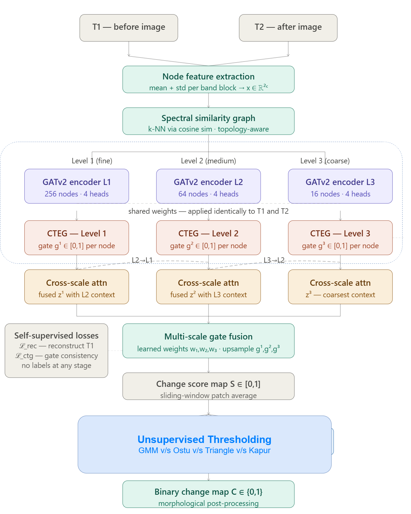
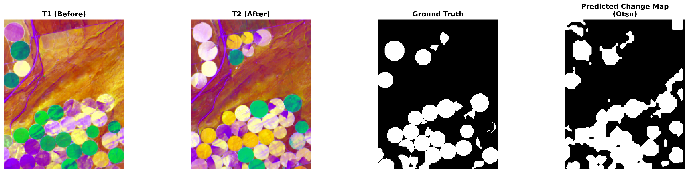
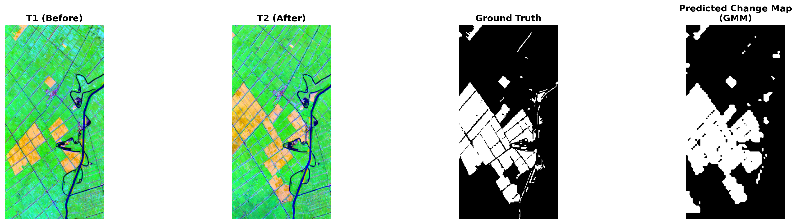

# THGCD-Net

**Topology-Aware Hierarchical Graph Change Detection Network for Unsupervised Hyperspectral Image Change Detection**

THGCD-Net detects land-cover change between two co-registered hyperspectral images **without any labels** — no annotated change maps are used for training at any stage.

> 📄 **Status:** Paper under review. Code will be released upon acceptance.
> M.Tech thesis, Department of Computer Science and Engineering, National Institute of Technology Calicut (2026).

<!-- Export Figure 4.2 from the thesis to assets/architecture.png -->


---

## Motivation

Pixel-level change annotations for hyperspectral imagery are expensive to produce, which limits supervised methods in practice. Existing unsupervised methods face four recurring limitations, which THGCD-Net addresses:

| Limitation | How THGCD-Net addresses it |
|---|---|
| Single-scale operation | Three-level GATv2 hierarchy (fine / medium / coarse) with cross-scale attention |
| Scalar change representation (Euclidean distance or subtraction) | Cross-Temporal Edge Gating (CTEG) with a four-view comparison |
| Sensor-specific design (fixed band count) | Node features of dimension 2C, so any band count works without redesign |
| Unreliable unsupervised thresholding | Systematic comparison of GMM, Otsu, Triangle and Kapur thresholding |

## Method

**1. Spectral node features.** Each 64 × 64 patch is divided into 4 × 4 pixel blocks. Each block becomes a graph node described by the per-band mean and standard deviation, giving a 2C-dimensional feature vector (C = 30 after PCA, so 60 dimensions).

**2. Topology-aware similarity graphs.** Separate k-nearest-neighbour graphs are built for T1 and T2 using cosine similarity, so nodes of the same land-cover type are connected regardless of spatial distance (k = 8 / 6 / 4 at the three levels).

**3. Hierarchical GATv2 encoder.** A shared-weight GATv2 encoder processes three levels — 256, 64 and 16 nodes per patch — with spatial average pooling between levels.

**4. Cross-Temporal Edge Gating (CTEG).** The core contribution. For each node, CTEG compares the T1 and T2 embeddings through four views:

$$\mathbf{c}_i = [\,\mathbf{h}^A_i \,\|\, \mathbf{h}^B_i \,\|\, \mathbf{h}^A_i - \mathbf{h}^B_i \,\|\, \mathbf{h}^A_i \odot \mathbf{h}^B_i\,]$$

A three-layer MLP maps this to a per-node change gate $g_i \in [0, 1]$, applied independently at all three levels.

<!-- Export Figure 4.3 from the thesis to assets/cteg.png -->


**5. Cross-scale attention and gate fusion.** Coarse context is propagated to finer levels (Level 3 → 2 → 1), and gates from all levels are fused with learned weights into the change score map.

**6. Self-supervised training.** Two losses, no labels:
- **Spectral reconstruction loss** — a decoder reconstructs T1 node features.
- **CTEG consistency loss** — gates are pushed to agree with spectral-difference pseudo-labels: nodes with normalised spectral difference below 0.15 are treated as confidently unchanged, above 0.50 as confidently changed, and ambiguous nodes are ignored.

**7. Hyperspectral adaptation.** PCA reduces the bands to 30 components (fitted on T1, applied to both dates, retaining over 99% of variance), and a squeeze-and-excitation Band Attention module weights informative bands.

**8. Inference.** Patch score maps are averaged with a sliding window, binarised with an unsupervised threshold, and cleaned with morphological opening and closing.

## Datasets

| Dataset | Sensor | Location | Dates | Size | Bands used | Change ratio |
|---|---|---|---|---|---|---|
| Hermiston | EO-1 Hyperion | Oregon, USA (irrigated farmland) | May 2004 / May 2007 | 225 × 180 | 159 → 30 PCA | 26.1% |
| Yancheng Wetland | EO-1 Hyperion | Jiangsu, China (wetland agriculture) | May 2006 / Apr 2007 | 430 × 220 | 132 → 30 PCA | 25.5% |

Both datasets are publicly available from [SicongLiuRS on GitHub](https://github.com/SicongLiuRS).

## Results

All results are fully unsupervised. Otsu thresholding is used as the single fixed threshold for both scenes.

| Dataset | F1 (%) | OA (%) | IoU (%) | Kappa (%) |
|---|---|---|---|---|
| Hermiston | 80.9 | 89.4 | 67.9 | 73.6 |
| Yancheng Wetland | 89.4 | 94.3 | 80.8 | 85.5 |

<details>
<summary>Thresholding comparison (F1 %)</summary>

| Threshold | Hermiston | Yancheng |
|---|---|---|
| GMM | 77.1 | 89.4 |
| **Otsu** | **80.9** | **89.4** |
| Triangle | 54.5 | 53.6 |
| Kapur | 80.5 | 80.2 |

Otsu and GMM consistently outperform Triangle and Kapur. Triangle, which targets skewed unimodal distributions, is poorly suited to the bimodal score maps THGCD-Net produces.
</details>

### Qualitative results

<!-- Export Figures 5.1 and 5.2 from the thesis to assets/ -->



<details>
<summary>Additional: OSCD Sentinel-2 multispectral (sensor-agnostic check)</summary>

The same architecture runs on 13-band Sentinel-2 data (input dimension 26) with no structural changes. Evaluated on the 8 OSCD cities with change ratio between 2% and 90%. F1 (%) with Otsu thresholding:

| Las Vegas | Montpellier | Cupertino | Dubai | Rennes | Hong Kong | Rio de Janeiro | Mumbai |
|---|---|---|---|---|---|---|---|
| 58.5 | 58.1 | 52.6 | 42.3 | 40.5 | 26.4 | 21.5 | 24.0 |

THGCD-Net was designed for hyperspectral data. Performance on urban multispectral scenes with low change ratios is notably lower.
</details>

## Implementation details

| Setting | Value |
|---|---|
| Framework | PyTorch, PyTorch Geometric |
| Parameters | ≈ 0.24M |
| Hidden / latent dimension | 64 / 32 |
| GATv2 heads | 4 |
| Optimiser | AdamW (lr 3 × 10⁻⁴, weight decay 10⁻⁴), cosine annealing |
| Epochs | 40, one model per scene |
| Precision | Mixed (FP16) |
| Hardware | Single NVIDIA T4 (16 GB) |

## Limitations

- **Pseudo-label dependence.** The consistency loss assumes changed regions show large spectral differences. This holds for agricultural and wetland scenes but weakens when atmospheric, seasonal or calibration effects dominate.
- **Spectral-only graph topology.** Spatial proximity is not used in graph construction, so spatial smoothness is not explicitly enforced.
- **Scene-specific training.** One model is trained per scene, so there is no zero-shot transfer yet.
- **Bi-temporal only.** Multi-temporal image series are not supported.

## Citation

```bibtex
@mastersthesis{fiya2026thgcdnet,
  title  = {Topology-Aware Hierarchical Graph Change Detection Network ({THGCD-Net}) for Unsupervised Hyperspectral Image Change Detection},
  author = {Fathima Fiya K M},
  school = {National Institute of Technology Calicut},
  year   = {2026},
  type   = {M.Tech Thesis}
}
```

The journal citation will be added after publication.

## Acknowledgements

This work was carried out at the Department of Computer Science and Engineering, National Institute of Technology Calicut, under the guidance of Dr. Manjusha K.
